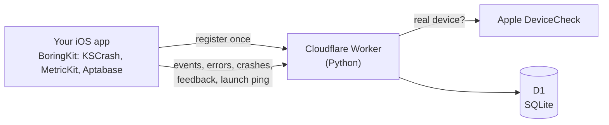

# Boring Ass App Kit

**The boring stuff every iOS app needs: crash reports, usage analytics, user feedback and update prompts. It all goes to your own Cloudflare Worker, with no paid product and no third-party SDK vendor.**

[](LICENSE)


-f38020.svg)

One Swift package goes into every app you make. One small Python Worker on Cloudflare's free plan collects the data in a SQLite database you own and query with plain SQL.

## What you get

| Feature | How |
|---|---|
| **Crash reporting** | [KSCrash](https://github.com/kstenerud/KSCrash) catches signals, Mach and ObjC/C++ exceptions, hangs and watchdog kills. Its MetricKit monitor adds the crash reports iOS collects itself. |
| **Usage analytics** | [aptabase-swift](https://github.com/aptabase/aptabase-swift) events and sessions, pointed at your Worker instead of Aptabase's cloud. |
| **Handled errors** | `Aptabase.shared.trackError(error)` for the errors you catch but didn't expect. |
| **User feedback** | `FeedbackView`, a ready-made SwiftUI sheet with an optional reply email, or `BoringKit.sendFeedback(_:)` for your own UI. |
| **Update prompt** | `.updatePrompt()` asks users on an old version to update and links to the App Store. You choose the version per app. |
| **Device check** | Devices register once through Apple DeviceCheck, so the API only accepts genuine Apple devices. Each device and IP is rate-limited. |
| **Your data, in SQL** | Everything lands in Cloudflare D1 (SQLite). Query it from the dashboard or the CLI. |

## How it works



1. On first launch, `BoringKit.start(api:)` gets a DeviceCheck token from Apple and posts it to `POST /v1/register`. The Worker asks Apple whether the token is genuine, then hands back a random device token and stores only its hash.
2. The app keeps that token in the Keychain (this device only) and sends it with every request. Requests without a known token get a 401.
3. On each launch, `POST /v1/ping` checks the token and sends the app's version. The reply says whether a newer version is out. If the ping gets a 401, the app registers again.
4. Aptabase sends events and errors to `/api/v0/events` and `/api/v0/error`, with the token in its `App-Key` header. Crash reports go to `/v1/crashes` on the next launch, and feedback goes to `/v1/feedback` right away.

## Requirements

- iOS 16 or later, and Xcode 16 or later (Swift 6)
- A Cloudflare account. The free plan is enough for small apps; see the [Workers](https://developers.cloudflare.com/workers/platform/limits/) and [D1](https://developers.cloudflare.com/d1/platform/limits/) limits.
- An Apple Developer Program membership, for the DeviceCheck key
- [uv](https://docs.astral.sh/uv/) and Node, to deploy the Worker

## Quick start

### 1. Deploy the API (once)

**Apple:** in the developer portal, go to Certificates, IDs & Profiles → Keys and create a key with **DeviceCheck** enabled. Download `AuthKey_XXXXXXXXXX.p8`, and note its Key ID and your Team ID. One key covers every app in the team, and apps need no extra entitlement.

**Cloudflare:** fork this repo (or see [Keeping your copy up to date](#keeping-your-copy-up-to-date) for a private copy), then:

```bash
cd api
uv run pywrangler login
uv run pywrangler deploy                      # creates the database, prints https://boring-api.<subdomain>.workers.dev
uv run pywrangler d1 migrations apply boring-api --remote
uv run pywrangler secret put APPLE_TEAM_ID
uv run pywrangler secret put APPLE_KEY_ID
uv run pywrangler secret put APPLE_DEVICECHECK_KEY < ~/Downloads/AuthKey_XXXXXXXXXX.p8
```

The first deploy writes the new database's ID into `wrangler.jsonc`. Discard that change with `git checkout wrangler.jsonc`: every command finds the database by name, and a copy without changes takes updates without conflicts. To deploy on every push instead, see [Deploying from GitHub](#deploying-from-github).

### 2. Add the package to your app

In Xcode, choose **File → Add Package Dependencies…**, enter `https://github.com/jkrenge/boring-ass-app-kit`, set the rule to **Up to Next Minor Version** from `0.1.0`, and add **BoringKit** to your app target.

Or, in a `Package.swift`:

```swift
.package(url: "https://github.com/jkrenge/boring-ass-app-kit", .upToNextMinor(from: "0.1.0")),
// target dependency:
.product(name: "BoringKit", package: "boring-ass-app-kit"),
```

### 3. Start it

```swift
import BoringKit
import SwiftUI

@main
struct MyApp: App {
    init() {
        BoringKit.start(api: URL(string: "https://boring-api.<subdomain>.workers.dev")!)
    }

    var body: some Scene {
        WindowGroup {
            ContentView().updatePrompt()
        }
    }
}
```

That's enough for crash reports and the update prompt. Add events, errors and feedback where they make sense; see [Usage](#usage).

### Or let your coding agent do it

Paste this into Claude Code, Codex, Cursor or another coding agent, from your app's repo:

```text
Add Boring Ass App Kit to this iOS app: crash reporting, analytics, handled errors,
a feedback screen and an update prompt. Follow the integration guide at
https://raw.githubusercontent.com/jkrenge/boring-ass-app-kit/main/AGENTS.md
My Worker URL is https://boring-api.<subdomain>.workers.dev
Suggest a few analytics events for the key actions in this app before adding them.
```

[AGENTS.md](AGENTS.md) tells the agent how to add the package, where to call what, and what never to track.

## Usage

```swift
// analytics: snake_case names; props can be String, Int, Double, Float or Bool. No personal data.
Aptabase.shared.trackEvent("export_tapped", with: ["format": "pdf"])

// an error you caught but didn't expect
Aptabase.shared.trackError(error)

// feedback
.sheet(isPresented: $showFeedback) { FeedbackView() }
let sent = await BoringKit.sendFeedback("Love it", email: nil)

// update prompt, or your own UI
ContentView().updatePrompt()
if let update = await BoringKit.availableUpdate() { /* update.version, update.url */ }
```

`import BoringKit` re-exports Aptabase. Debug builds are flagged `is_debug = 1`, so you can filter them out.

### Telling users about an update

Once a release is live on the App Store, set its version in the `apps` table. It takes effect right away, with no deploy:

```bash
uv run pywrangler d1 execute boring-api --remote --command "INSERT OR REPLACE INTO apps (bundle_id, version, url) VALUES ('com.you.app', '1.4.0', 'https://apps.apple.com/app/id1234567890')"
```

The table only takes `https://apps.apple.com/` links. A version that isn't up to three numbers, such as `1.4.0`, switches the prompt off for that app.

On their next launch, users on an older version get an "Update available" alert with **Update**, which opens the App Store, and **Not now**. It asks again on every launch until they update. Bump the version only after the release is live, or the App Store won't have the update yet when users get there. A phased release is fine, because users can always update by hand.

## Reading your data

Use the Cloudflare dashboard (D1 → `boring-api` → Console), or run `uv run pywrangler d1 execute boring-api --remote --json --command "…"`. Keep `--json` on: the Worker strips control characters, but rows an older Worker stored may still hold terminal escape codes a device sent, and the JSON output escapes them.

```sql
-- daily active devices per app (release builds)
SELECT d.bundle_id, date(e.ts) AS day, count(DISTINCT e.device_id) AS devices, count(*) AS events
FROM events e JOIN devices d ON d.id = e.device_id
WHERE e.is_debug = 0 GROUP BY 1, 2 ORDER BY day DESC;

-- which versions people are on (last 30 days)
SELECT d.bundle_id, json_extract(e.system, '$.appVersion') AS version, count(DISTINCT e.device_id) AS devices
FROM events e JOIN devices d ON d.id = e.device_id
WHERE e.is_debug = 0 AND date(e.ts) > date('now', '-30 days')
GROUP BY 1, 2 ORDER BY 1, 3 DESC;

-- latest crashes, release builds only, without MetricKit's second copy of crashes KSCrash already caught
SELECT c.id, d.bundle_id, c.received_at,
       json_extract(c.report, '$.system.CFBundleShortVersionString') AS version,
       json_extract(c.report, '$.report.monitor_id') AS source,
       json_extract(c.report, '$.crash.error.type') AS type,
       json_extract(c.report, '$.crash.error.signal.name') AS signal,
       json_extract(c.report, '$.crash.error.reason') AS reason
FROM crashes c JOIN devices d ON d.id = c.device_id
WHERE ifnull(json_extract(c.report, '$.system.build_type'), '') NOT IN ('debug', 'simulator')
  AND NOT (json_extract(c.report, '$.report.monitor_id') = 'MetricKit'
           AND EXISTS (SELECT 1 FROM crashes k
                       WHERE k.device_id = c.device_id
                         AND json_extract(k.report, '$.report.run_id') = json_extract(c.report, '$.report.run_id')
                         AND ifnull(json_extract(k.report, '$.report.monitor_id'), '') <> 'MetricKit'))
ORDER BY c.id DESC LIMIT 20;

-- handled errors by type
SELECT type, count(*) AS n, max(received_at) AS last_seen FROM errors WHERE is_debug = 0 GROUP BY type ORDER BY n DESC;

-- feedback
SELECT f.received_at, d.bundle_id, f.message, f.email, f.meta
FROM feedback f JOIN devices d ON d.id = f.device_id ORDER BY f.id DESC;
```

In release builds, your own code shows up in crash stacks as raw addresses. Symbolicate them with the build's dSYM:
`atos -o MyApp.app.dSYM/Contents/Resources/DWARF/MyApp -l <load address> <address>`.

## Deploying from GitHub

[`.github/workflows/deploy.yml`](.github/workflows/deploy.yml) runs the tests, applies migrations and deploys the Worker on every push to `main` that changes `api/`. You can also run it by hand from the Actions tab. GitHub turns Actions off in a new fork, so turn them on in its **Actions** tab first. The workflow does nothing until you configure it, under **Settings → Secrets and variables → Actions**:

| Name | Kind | Value |
|---|---|---|
| `CLOUDFLARE_API_TOKEN` | Secret | A Cloudflare API token from the **Edit Cloudflare Workers** template, with **Account → D1 → Edit** added |
| `CLOUDFLARE_ACCOUNT_ID` | Variable | Your account ID, from the Cloudflare dashboard |
| `API_DOMAIN` | Variable, optional | A hostname on a domain in your Cloudflare account, such as `api.example.com`. The Worker is then served only there, and `workers.dev` is turned off. |

The first run creates the D1 database and the Worker. Then set the Apple secrets once with `pywrangler secret put`, as in the quick start. They stay on the Worker, and the workflow never sees them.

**Set `API_DOMAIN` before you ship an app.** Apps call the URL they were built with, so turning off `workers.dev` cuts off every installed version that uses it.

## Keeping your copy up to date

Everything specific to your deployment lives outside the code: app versions in D1, keys in Worker secrets, and deploy settings in GitHub variables. So your copy never needs to differ from this repo.

- **A fork:** click **Sync fork** on GitHub. With the workflow set up, that push deploys the new Worker.
- **Without the workflow:** `git pull`, then in `api/` run `uv run pywrangler d1 migrations apply boring-api --remote` and `uv run pywrangler deploy`.
- **A private copy:** a fork of a public repo is public. That's fine, since nothing private goes in it, but if you'd rather keep yours private, make an empty private repo and push a clone of this one to it:

  ```bash
  git clone https://github.com/jkrenge/boring-ass-app-kit boring-api && cd boring-api
  git remote rename origin upstream
  git remote add origin https://github.com/<you>/boring-api
  git push -u origin main
  ```

  To update, run `git pull upstream main && git push`.

**Update the Worker before the package in your apps.** The Worker API only ever grows, so older apps keep working with a newer Worker, but a newer BoringKit may call something an older Worker doesn't have. The [changelog](CHANGELOG.md) marks Worker changes with "Worker:".

## Privacy

- **No user identity.** Each install gets a random token, and the Worker stores only its sha256. There's no advertising ID and no account ID. The Worker uses IP addresses for rate limiting and never writes them to D1. Cloudflare's own Worker logs, which `wrangler.jsonc` turns on, keep request details for a few days.
- **What's stored:** events with their props, plus device model, OS, locale and app version; crash reports; handled errors; and feedback, with an email only if the user typed one.
- **App Store privacy label:** declare Crash Data, Performance Data, Product Interaction and Other Diagnostic Data, none of them linked to the user's identity. If you keep the optional feedback email, also declare Email Address. KSCrash and Aptabase ship their own privacy manifests.

## Security model

DeviceCheck shows that a registration came from a real Apple device. It doesn't prove the request came from your unmodified app; App Attest would, at much more cost. The bundle ID is self-reported. Cloudflare's rate limits (about 120 requests a minute per device, with large crash reports counting for more, and 10 registrations a minute per IP) are approximate and counted per location, so they slow a flood down but don't cap storage. Requests with a made-up token cost a Worker request and a D1 read each, and the free plan allows 100,000 Worker requests a day. Past that, the API stops answering until the daily reset, which costs data but no money. Even one registered device can write about 3,000 events a minute. That uses up the free plan's 100,000 row writes for the day within about half an hour, and could fill its 500 MB within an hour or so. There's no per-device daily quota yet. **This is meant to keep out casual junk, not a determined attacker.**

The Simulator can't make DeviceCheck tokens. The Worker accepts tokenless registration only when `ALLOW_UNATTESTED=true`, which belongs in `api/.dev.vars` for local dev and never in production.

**Revoking a token:** `UPDATE devices SET token_hash = 'revoked-' || id WHERE id = 42;`. This doesn't ban the device. On its next launch, the ping gets a 401 and a genuine device simply registers again. A real ban would need something that survives re-registration, such as DeviceCheck's two per-device bits, and that isn't built. The same ping is what lets every install recover if the database is ever reset.

### Hardening on your own domain

On your own domain, Cloudflare's WAF can drop junk before it reaches the Worker, so it never counts against your Worker or D1 quotas. WAF rules don't apply to `workers.dev`, which is why `API_DOMAIN` turns it off. The free plan includes both of these rules:

1. **Custom rule** (Security → WAF → Custom rules) with the action **Block**. It blocks anything that isn't one of the kit's six API calls, and any call except registration that has no device token. The kit's apps never send either. Replace `api.example.com` with your API's hostname, so the rule leaves the rest of your domain alone:
   ```
   http.host eq "api.example.com" and (
     not (http.request.method eq "POST" and http.request.uri.path in {"/v1/register" "/v1/ping" "/api/v0/events" "/api/v0/error" "/v1/crashes" "/v1/feedback"})
     or (http.request.uri.path ne "/v1/register"
         and not any(lower(http.request.headers.names[*])[*] eq "authorization")
         and not any(lower(http.request.headers.names[*])[*] eq "app-key"))
   )
   ```
2. **Rate limiting rule** (Security → WAF → Rate limiting rules). On the free plan it can only match the path, and it counts per IP over 10 seconds. Match `http.request.uri.path in {"/v1/register" "/v1/ping" "/api/v0/events" "/api/v0/error" "/v1/crashes" "/v1/feedback"}`, and block for 10 seconds at about 100 requests. Many phone users can share one IP behind their carrier's NAT, so keep the limit generous.

Leave **Bot Fight Mode** off on the domain that serves the API. It challenges requests in a way a native app can't answer, it applies to the whole domain, and on the free plan no rule can exempt the API from it. DeviceCheck already does that job here.

To report a vulnerability, see [SECURITY.md](SECURITY.md).

## Local development

See [CONTRIBUTING.md](CONTRIBUTING.md) for running the Worker locally, the unit tests, and the Simulator integration test that checks every kind of data reaches D1.

## Built on

- [KSCrash](https://github.com/kstenerud/KSCrash) by Karl Stenerud: crash reporting (MIT)
- [aptabase-swift](https://github.com/aptabase/aptabase-swift) by Sumbit Labs: analytics client (MIT)
- [Cloudflare Python Workers](https://developers.cloudflare.com/workers/languages/python/) and [D1](https://developers.cloudflare.com/d1/)
- [Apple DeviceCheck](https://developer.apple.com/documentation/devicecheck)

## License

[MIT](LICENSE) © 2026 Julian Krenge
